<div align="center">

# Abdenour Benkorich

### Fullstack Engineer · Mobile Architect · Data Science & AI Builder

<p align="center">
  <a href="https://bencoder.netlify.app/"></a>
  <a href="https://linkedin.com/in/abdenour-benkorich"></a>
  <a href="mailto:ben.coder.01@gmail.com"></a>
  <a href="https://discord.gg/dCSPTzk6rs"></a>
  
</p>

<!-- ================================================================= -->
<!-- 1. HERO TERMINAL PAIR: PROFILE SPEC CARD + LIVE ANALYTICS         -->
<!-- ================================================================= -->

<table>
  <tr>
    <td width="420" valign="top">
      
    </td>
    <td width="420" valign="top">
      
    </td>
  </tr>
</table>

<br>

<!-- ================================================================= -->
<!-- 2. LIVE 53-WEEK CONTRIBUTION HEATMAP (Auto-Refreshed Daily)       -->
<!-- ================================================================= -->


<p align="center">
  <sub><i>Self-contained SVG engine with native SMIL/CSS animations · Auto-refreshed daily via GitHub Actions · Zero 3rd-party dependencies</i></sub>
</p>

</div>

---

## 👨‍💻 Executive Summary

```typescript
interface SeniorEngineer {
  name: string;
  title: string;
  location: string;
  academics: string;
  ventures: string[];
  coreStrengths: string[];
  currentFocus: string[];
  availability: string;
}

const abdenour: SeniorEngineer = {
  name: "Abdenour Benkorich",
  title: "Fullstack Engineer & Mobile Architect",
  location: "Mostaganem, Algeria 🇩🇿 (UTC+1)",
  academics: "B.Sc. Data Science & Artificial Intelligence @ University of Mostaganem",
  ventures: ["Startup Founder · 0 → 1 Stealth Digital Product"],
  coreStrengths: [
    "Fullstack Web Application Architecture (React, Next.js, TypeScript, Tailwind)",
    "Cross-Platform & Native Mobile Engineering (React Native, Flutter, Native APIs)",
    "Distributed Backend Systems & Scalable APIs (FastAPI, NestJS, Node.js, PostgreSQL)",
    "Applied Machine Learning & Computer Vision (PyTorch, OpenCV, Scikit-Learn)",
    "Embedded IoT & Robotics Systems (ESP32, STM32, Arduino, ROS)"
  ],
  currentFocus: [
    "Engineering high-velocity web and mobile architectures with clean UX",
    "Deploying machine intelligence pipelines into production applications"
  ],
  availability: "Available for High-Impact Contracting, Technical Leadership & Ventures"
};
```

---

## ⚡ What I'm Building

- 🚀 **Startup Launch (0 → 1)** — Founder & fullstack engineer building a high-velocity digital platform from ground up, emphasizing scalability, modern UX, and real-time workflows.
- 📱 **Mobile Architectures** — Designing cross-platform applications with smooth 60fps gesture handling, offline-first sync, and robust state management.
- 🧠 **Applied AI & Computer Vision** — Training and deploying practical deep learning models for image processing, classification, and intelligent automation.
- ⚡ **Embedded Systems** — Interfacing hardware sensors, microcontrollers (ESP32, STM32), and ROS nodes with cloud backends.

---

## 🛠️ Technical Competencies

| Domain | Technologies & Frameworks |
| :--- | :--- |
| **Frontend Architecture** | React, Next.js, TypeScript, Vue.js, JavaScript (ESNext), Tailwind CSS, HTML5, CSS3/Sass |
| **Mobile Development** | React Native, Flutter, Dart, Kotlin, Swift, Cross-Platform UI |
| **Backend & Distributed Systems** | Node.js, NestJS, FastAPI, Express.js, Python, RESTful APIs, GraphQL, WebSockets |
| **Data Science & AI / ML** | PyTorch, TensorFlow, Scikit-Learn, OpenCV, Pandas, NumPy, Data Pipelines |
| **Databases & Caching** | PostgreSQL, Redis, MongoDB, Supabase, SQLite, Prisma ORM |
| **DevOps & Cloud** | Docker, Linux (POSIX), GitHub Actions CI/CD, Nginx, Vite, Git Flow |
| **Embedded & Robotics** | ESP32, STM32, Arduino, Raspberry Pi, Robot Operating System (ROS) |
| **Workstation & Tooling** | macOS (Apple Silicon), Arch Linux, Ghostty, zsh, Neovim, VS Code |

---

## 🌐 Connect & Collaborate

I am always interested in discussing new ventures, engineering challenges, and high-impact projects.

<div align="center">

[](https://bencoder.netlify.app/)
[](https://linkedin.com/in/abdenour-benkorich)
[](mailto:ben.coder.01@gmail.com)
[](https://discord.gg/dCSPTzk6rs)

<br>

**Mostaganem, Algeria 🇩🇿 · Open to Global Remote Opportunities**

</div>
