<div align="center">

# Abdenour Benkorich (BenCoder)

### AI Instructor · Full-Stack Software Engineer · Data Science · Tech Content Creator

<p align="center">
  <a href="https://bencoder.site"></a>
  <a href="https://instagram.com/ben.coderr"></a>
  <a href="https://www.udemy.com/course/bencoderr-python-course-arabic/"></a>
  <a href="https://linkedin.com/in/danour"></a>
  <a href="mailto:benkorich.abdenour@gmail.com"></a>
  
</p>

<!-- ================================================================= -->
<!-- 1. HERO TERMINAL PAIR: PROFILE SPEC CARD + LIVE ANALYTICS         -->
<!-- ================================================================= -->

<table>
  <tr>
    <td width="420" valign="top">
      
    </td>
    <td width="420" valign="top">
      
    </td>
  </tr>
</table>

<br>

<!-- ================================================================= -->
<!-- 2. LIVE 53-WEEK CONTRIBUTION HEATMAP (Auto-Refreshed Daily)       -->
<!-- ================================================================= -->



<p align="center">
  <sub><i>Self-contained SVG engine with native SMIL/CSS animations · Auto-refreshed daily via GitHub Actions · Zero 3rd-party runtime dependencies</i></sub>
</p>

</div>

---

## ⚡ Quick Impact Metrics

| Metric | Achievement / Responsibility | Scope |
| :--- | :--- | :--- |
| **102,000+** | **Developer Community** reached via **BenCoder** | Arabic tech tutorials, AI guides & system breakdowns *(est. 2022)* |
| **Lead AI Instructor** | **Everest Academy** | Spearheading the intensive *"Build with AI"* bootcamp (LLMs & Agents) |
| **300+ Learners · 4.8★** | **Udemy Course Author** | *"Python for Beginners in Arabic"* (algorithmic thinking to OOP) |
| **Speaker & Instructor** | **University & Tech Hubs** | Multi-city technical workshops across Tlemcen, Algiers & Oran *(since 2023)* |
| **State Engineer (PFE 2026)** | **Computer Engineering & Data Science** | 5-year integrated program @ Université Abdelhamid Ibn Badis |
| **Sub-300ms** | **Production Edge Latency** | Architected **JG SupplyNet** (Algeria's digital B2B procurement network) |

---

## 👨‍💻 Executive Summary

```typescript
interface SeniorEngineer {
  name: string;
  brand: string;
  title: string;
  location: string;
  academics: string;
  pedagogy: string[];
  flagshipArchitectures: string[];
  coreStrengths: string[];
  availability: string;
}

const abdenour: SeniorEngineer = {
  name: "Abdenour Benkorich",
  brand: "BenCoder",
  title: "AI Instructor | Full-Stack Software Engineer | Data Science",
  location: "Mostaganem, Algeria 🇩🇿 (UTC+1 · Worldwide Remote)",
  academics: "State Engineering Degree in Computer Engineering & Data Science @ Univ Mostaganem",
  pedagogy: [
    "Lead AI Instructor @ Everest Academy ('Build with AI' Bootcamp)",
    "Creator @ BenCoder (102K+ Community across Algeria & Arab region, est. 2022)",
    "Author of Top-Rated Udemy Python Course (300+ students, 4.8★ rating)",
    "Technical Speaker & Workshop Instructor (Multi-city events across Tlemcen, Algiers & Oran, since 2023)"
  ],
  flagshipArchitectures: [
    "JG SupplyNet — Algerian National B2B Procurement Network (Sub-300ms, EN/FR/AR)",
    "PhytoSense — Dual-Vision LLM Ethnobotany Intelligence Platform (PFE 2026)",
    "VYRO — Made-to-Order Manufacturing Storefront with Chargily Pay (CIB/Edahabia)",
    "New Way — AI Revenue Forecasting SaaS with Streaming Gemini & Linear Regression"
  ],
  coreStrengths: [
    "Production Full-Stack Architecture (Next.js 16, React 19, Astro 5, TypeScript, Tailwind)",
    "Applied AI & LLM Systems (Gemini 3.8 Flash, Groq LPU, Vercel AI SDK, Prompt Eng, Ollama)",
    "High-Performance Backends & Data (FastAPI, Python, Node.js, PostgreSQL, Redis, SQLite FTS5)",
    "Hardware Telemetry & Robotics (DZDuino Labs, Arduino, ESP32, Raspberry Pi, Sensors)",
    "Algerian Integrations (Chargily Pay CIB/Edahabia, National Logistics & Freight Tables)"
  ],
  availability: "Available for AI Teaching, Technical Speaking, High-Impact Engineering & Ventures"
};
```

---

## 🚀 Shipped Production Architectures & Case Studies

<table>
  <thead>
    <tr>
      <th width="28%">Platform / System</th>
      <th width="42%">Architecture & Highlights</th>
      <th width="30%">Core Technologies</th>
    </tr>
  </thead>
  <tbody>
    <tr>
      <td>
        <b><a href="https://www.jgsupplynet.com">JG SupplyNet</a></b><br>
        <sub>Algerian B2B Procurement Hub</sub>
      </td>
      <td>
        Algeria's premier multi-lingual digital B2B procurement network and RFQ platform. Features trilingual localization (EN · FR · AR), sub-300ms server response times, high-concurrency quotation pipelines, and supplier dashboards.
      </td>
      <td>
        <code>Next.js</code> · <code>TypeScript</code> · <code>Tailwind</code> · <code>PostgreSQL</code> · <code>Prisma</code>
      </td>
    </tr>
    <tr>
      <td>
        <b><a href="https://phyto-sense-rose.vercel.app">PhytoSense</a></b><br>
        <sub>AI Ethnobotany Platform (PFE 2026)</sub>
      </td>
      <td>
        Scientific pharmacology intelligence platform for 156+ Algerian medicinal plants. Built with zero-downtime dual-vision failover (Pl@ntNet ➔ Kindwise Plant.id), cascading LLMs (Gemini Flash ➔ Groq), and offline SQLite FTS5 mobile engine.
      </td>
      <td>
        <code>React Native</code> · <code>Expo 57</code> · <code>FastAPI</code> · <code>Gemini</code> · <code>Groq</code> · <code>SQLite FTS5</code>
      </td>
    </tr>
    <tr>
      <td>
        <b><a href="https://vyro-web-eight.vercel.app">VYRO</a></b><br>
        <sub>Made-to-Order Storefront</sub>
      </td>
      <td>
        Monorepo manufacturing storefront with custom 3D/CNC CAD configuration pipeline, automated production order routing, and real-time payment settlement via Chargily Pay (Edahabia & CIB cards).
      </td>
      <td>
        <code>Turborepo</code> · <code>Next.js 16</code> · <code>React 19</code> · <code>Chargily Pay</code> · <code>PostgreSQL</code>
      </td>
    </tr>
    <tr>
      <td>
        <b><a href="https://new-way-proj.vercel.app">New Way</a></b><br>
        <sub>AI Revenue Forecasting SaaS</sub>
      </td>
      <td>
        Financial intelligence SaaS featuring automated CSV/Excel schema inference, 30-day linear regression forecasting, Recharts data visualization, and streaming Gemini narrative reasoning.
      </td>
      <td>
        <code>Next.js</code> · <code>TypeScript</code> · <code>PapaParse</code> · <code>Recharts</code> · <code>Vercel AI SDK</code>
      </td>
    </tr>
    <tr>
      <td>
        <b><a href="https://dzduino.com">DZDuino Labs</a></b><br>
        <sub>Embedded Robotics & IoT</sub>
      </td>
      <td>
        Conducted hands-on robotics labs teaching sensor telemetry (HC-SR04, MPU-6050 6-DOF IMU), PWM motor actuation, I2C/SPI protocols, and real-time C/C++ microcontroller firmware.
      </td>
      <td>
        <code>Arduino Uno</code> · <code>ESP32</code> · <code>Raspberry Pi 4</code> · <code>C/C++</code> · <code>Python GPIO</code>
      </td>
    </tr>
  </tbody>
</table>

---

## 🛠️ Technical Competencies & Arsenal

| Domain | Technologies & Competencies |
| :--- | :--- |
| **Artificial Intelligence & LLMs** | Large Language Models (LLMs), Google Gemini 3.8 Flash, Groq LPU, Vercel AI SDK, Prompt Engineering & Personas, Context Architecture, Multi-Provider Failover Cascading, Local Inference (Ollama), Vector Embeddings & Similarity Search (ChromaDB, pgvector), PyTorch |
| **Full-Stack & Frontend Architecture** | TypeScript, React 19, Next.js 16 (App Router, Server Actions), Astro 5, Tailwind CSS (v3 & v4), Turborepo Monorepo Architecture, HTML5, CSS3, WCAG 2.1 AA Accessibility, Core Web Vitals Optimization |
| **Mobile Engineering** | React Native, Expo SDK 57, Offline-First Architecture, SQLite FTS5, Gesture Handling, Native APIs |
| **Backend & Distributed Systems** | Python 3, FastAPI, Node.js, Express.js, Django, RESTful APIs, PostgreSQL, MongoDB, Redis, Prisma ORM, Data Pipeline Design |
| **Algerian Integrations & Payments** | Chargily Pay (Edahabia & CIB Cards), Cash on Delivery (COD) State Machines, Yalidine & ZR Express Logistics Tables, Pl@ntNet API, Kindwise API |
| **Robotics & Embedded Systems** | Microcontroller Firmware, Arduino Uno (ATmega328P), Raspberry Pi 4 (Linux Edge Compute), ESP32, Embedded C/C++, Python GPIO, Sensor Telemetry (Ultrasonic, IMU, IR), PWM Actuation, I2C, SPI, UART |
| **Tooling & Environment** | macOS (Apple Silicon), Arch Linux, Ghostty, zsh, Neovim, VS Code, Git Flow, Docker, GitHub Actions CI/CD |

---

## 🎙️ Pedagogy, Community & Speaking

- 🎓 **Everest Academy:** Lead AI Instructor heading the *"Build with AI"* intensive formation, mentoring students from fundamental Python and prompt engineering to production AI applications.
- 🌐 **BenCoder Platform (est. 2022):** Over **102,000+** Arabic developers engaged on Instagram ([@ben.coderr](https://instagram.com/ben.coderr)) and developer platforms with 45+ in-depth video breakdowns and guides.
- 📚 **Udemy Course Author:** *"Python for Beginners in Arabic"* with **300+** students and a **4.8★** rating.
- 🗣️ **Technical Speaker & Workshops (since 2023):** Conducting hands-on software development bootcamps, algorithmic seminars, and web engineering workshops across university hubs in Tlemcen, Algiers, and Oran.

---

## 🌐 Connect & Collaborate

I am always open to discussing AI curriculum design, technical workshops, engineering leadership, and high-impact ventures.

<div align="center">

[](https://bencoder.site)
[](https://instagram.com/ben.coderr)
[](https://linkedin.com/in/danour)
[-A435F0?style=for-the-badge&logo=udemy&logoColor=white)](https://www.udemy.com/course/bencoderr-python-course-arabic/)
[](mailto:benkorich.abdenour@gmail.com)

<br>

**Mostaganem, Algeria 🇩🇿 · Open to Global Remote Engagements**

</div>
