<div align="center">

<!-- ================================================================= -->
<!-- 1. HERO TERMINAL: SELF-TYPING CYBER ART + NEOFETCH SYSTEM CARD   -->
<!-- ================================================================= -->

<h3><code>┌──(ben㉿cyberdeck)-[~] $ ./whoami.sh --neural-link</code></h3>

<table>
  <tr>
    <td valign="top"></td>
    <td valign="top"></td>
  </tr>
</table>

<br><br>

<!-- ================================================================= -->
<!-- 2. LIVE NEO-MATRIX CONTRIBUTION HEATMAP (Auto-Refreshed Daily)   -->
<!-- ================================================================= -->

<h3><code>┌──(ben㉿cyberdeck)-[~] $ ./contributions.sh --live-matrix</code></h3>



<br><br>

<!-- ================================================================= -->
<!-- 3. NEURAL FREQUENCIES & CONNECT                                  -->
<!-- ================================================================= -->

<h3><code>┌──(ben㉿cyberdeck)-[~] $ ./connect.sh</code></h3>

<p><b>Fullstack Engineer · Mobile Architect · Data Science & AI Builder · Startup Founder</b></p>

[](https://bencoder.netlify.app/)
[](https://linkedin.com/in/abdenour-benkorich)
[](https://instagram.com/ben.coderr)
[](https://discord.gg/dCSPTzk6rs)
[](mailto:ben.coder.01@gmail.com)

<br>

</div>

---

## ⚡ What I'm Building (0 → 1)

<div align="center">

> *"The best way to predict the future is to build it."*

</div>

I am building and launching my own **startup** — combining high-velocity frontend craftsmanship, data-driven intelligence, and scalable backend architecture to turn ideas into real products.

- 🚀 **Startup Launch** — Early-stage stealth product in active engineering
- 🧠 **Data Science & AI** — Practical ML models, deep neural architectures, and intelligent workflows
- 🌍 **Vision** — High-impact software experiences with razor-sharp UX across MENA & beyond

---

## 🛠️ Specialized Arsenal

### 🎨 Frontend & Web Architecture
<p>
  
</p>

> TypeScript · Next.js · React · Vue · Nuxt.js · Tailwind CSS · SASS · Bootstrap · Responsive UI/UX

### 📱 Cross-Platform & Native Mobile
<p>
  
</p>

> React Native · Expo · Flutter · Kotlin · Swift · iOS & Android Native Modules

### ⚙️ Scalable Backends & Distributed Systems
<p>
  
</p>

> Node.js · **NestJS** · FastAPI · Python · PostgreSQL · Redis · MongoDB · Supabase · Firebase · REST & GraphQL

### 🧠 Data Science, Machine Learning & Computer Vision
<p>
  
</p>

> PyTorch · TensorFlow · Scikit-learn · OpenCV · NumPy · Pandas · Matplotlib · Jupyter Notebooks

### 🤖 Embedded Systems, IoT & Robotics
<p>
  
</p>

> ESP32 · STM32 · Arduino · Raspberry Pi · ROS (Robot Operating System) · C / C++ · MicroPython

### 🔧 DevOps, Tooling & Environments
<p>
  
</p>

> Git · GitHub Actions CI/CD · Docker · Linux / Arch / macOS · Vite · Postman · Figma

---

## 🧭 Dev Journey

```
2020 ──── HTML / CSS / JavaScript                  🟢 Mastered
2021 ──── React · Vue · Bootstrap · SASS           🟢 Mastered
2022 ──── Figma · Git · Python · Arduino           🟢 Mastered
2023 ──── React Native · Node.js · MongoDB         🟡 Proficient
2024 ──── Data Science · ML · FastAPI · Docker     🟡 Proficient
2025 ──── Startup Launch · Full-Product Ownership  🔵 In Progress
         └── AI Integration · Cloud Architecture  🔵 Learning
```

<br>

<div align="center">
  <b>💬 Open to collaborations, high-conviction engineering, or startup discussions. Reach out anytime!</b>
</div>
