<div align="center">

<!-- ================================================================= -->
<!-- 1. LIVE ANIMATED CONTRIBUTION HEATMAP                             -->
<!-- Auto-refreshed daily by .github/workflows/update-profile-art.yml  -->
<!-- ================================================================= -->

<h3><code>benkorich@github ~ $ ./contributions.sh</code></h3>


<br><br>

<!-- ================================================================= -->
<!-- 2. TERMINAL WHOAMI: SELF-TYPING ASCII EMBLEM + NEOFETCH CARD     -->
<!-- ================================================================= -->

<h3><code>benkorich@github ~ $ whoami</code></h3>

<table>
  <tr>
    <td valign="top"></td>
    <td valign="top"></td>
  </tr>
</table>

<br><br>

<!-- ================================================================= -->
<!-- 3. LIVE ACTIVITY METRICS & MONTHLY BREAKDOWN                     -->
<!-- ================================================================= -->

<h3><code>benkorich@github ~ $ ./stats.sh</code></h3>



<br><br>

<!-- ================================================================= -->
<!-- 4. QUICK LINKS & CONNECT                                          -->
<!-- ================================================================= -->

<h3><code>benkorich@github ~ $ ./links.sh</code></h3>

<p><b>Fullstack Engineer · Mobile Architect · Data Science & AI Builder</b></p>

[](https://bencoder.netlify.app/)
[](https://linkedin.com/in/abdenour-benkorich)
[](https://instagram.com/ben.coderr)
[](https://discord.gg/dCSPTzk6rs)
[](mailto:ben.coder.01@gmail.com)

<br>

</div>

---

## 🚀 What I'm Building

<div align="center">

> *"The best way to predict the future is to build it."*

</div>

I am currently focused on building and launching my own **startup** — combining frontend craftsmanship, data-driven thinking, and product design to ship products from 0 → 1.

- 💼 **Startup** — Early-stage product in active development
- 📊 **Data Science & AI** — Practical ML/AI applied to real-world software
- 🌍 **Mission** — Creating high-impact software experiences in MENA & beyond

---

## 🛠️ Full Tech Stack

### 🎨 Frontend & Web
<p>
  
</p>

> React · Next.js · Vue · Nuxt.js · Tailwind CSS · TypeScript · SASS · Bootstrap

### 📱 Mobile Development
<p>
  
</p>

> React Native · Expo · Flutter · Kotlin · Swift · Cross-platform & Native

### ⚙️ Backend & APIs
<p>
  
</p>

> Node.js · Express · **NestJS** · FastAPI · Python · PostgreSQL · Redis · MongoDB · Supabase · Firebase

### 🧠 Data Science, AI & Machine Learning
<p>
  
</p>

> PyTorch · TensorFlow · Scikit-learn · OpenCV · Pandas · NumPy · Matplotlib · Jupyter

### 🤖 Embedded Systems & Robotics
<p>
  
</p>

> ESP32 · STM32 · Arduino · Raspberry Pi · ROS (Robot Operating System) · C / C++ · MicroPython

### 🔧 DevOps, Cloud & Tools
<p>
  
</p>

> Git · GitHub Actions · Docker · Linux · Vite · Postman · Figma

---

## 🧭 Dev Journey

```
2020 ──── HTML / CSS / JS                          🟢 Mastered
2021 ──── React · Vue · Bootstrap · SASS           🟢 Mastered
2022 ──── Figma · Git · Python · Arduino           🟢 Mastered
2023 ──── React Native · Node.js · MongoDB         🟡 Proficient
2024 ──── Data Science · ML · FastAPI · Docker     🟡 Proficient
2025 ──── Startup Launch · Full-Product Ownership  🔵 In Progress
         └── AI Integration · Cloud Architecture  🔵 Learning
```

<br>

<div align="center">
  <b>💬 Open to collaborations, freelance engineering, or high-conviction startup conversations. Reach out anytime!</b>
</div>
